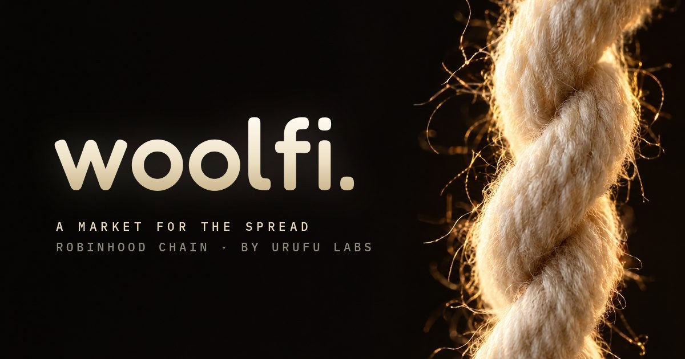

<div align="center">



# woolfi

**a market for the spread on Robinhood Chain**

*Two strands: the pool's price and the real price. The fee keeps pulling them back together.*

<br />

[](https://github.com/sp0oby/woolfi/actions/workflows/ci.yml)
[](./docs/robinhood-deployment.md)
[](#-status)
[](./foundry.toml)
[](./src/WoolFiHook.sol)

<br />

[**◦ spec**](./PROJECT_SPEC.md) ・ [**◦ contracts**](./src) ・ [**◦ audit pack**](./docs/audit) ・ [**◦ runbooks**](./docs/runbooks) ・ [**◦ arb agent**](./arb-agent) ・ [**◦ security**](./SECURITY.md) ・ [**◦ x**](https://x.com/urugemu)

</div>

<br />

> WoolFi is a Uniswap v4 hook and an 18-pool market for Robinhood Stock Tokens, WETH and USDG
> on Robinhood Chain, built by **Urufu Labs**. Each pool looks like an ordinary v4 pool from the
> outside: you swap, add liquidity, collect fees. Underneath, the hook prices every trade against
> an oracle fair value, so the pool trades the *relationship* between two assets and keeps
> pulling itself back to it. **Pre-launch and unaudited.**

---

## ✧ what woolfi is

If you wanted to express "the MSTR premium is too wide" on-chain today, you'd need a perp short on
one side, spot on the other, two collateral accounts, funding, and counterparty risk in two
venues. Or two concentrated-liquidity positions you rebalance by hand.

WoolFi collapses that into a swap. You buy or sell the spread. The LPs on the other side collect
the fee. When the spread mean-reverts, LPs win; when a correlation breaks, a per-pool URU vault
funds the rebalance back to fair.

<br />

<div align="center">

<table>
<tr>
<td align="center" width="240"><h3>trade</h3></td>
<td align="center" width="240"><h3>provide</h3></td>
<td align="center" width="240"><h3>underwrite</h3></td>
</tr>
<tr>
<td align="left" valign="top">
Swap MSTR, NVDA, SPY and more against USDG or WETH. Trades that pull a pool toward fair pay
less than the base fee; trades that push it away pay more.
</td>
<td align="left" valign="top">
Deposit both assets, Zap in with one token, or migrate a Uniswap v3 position in one
transaction. Full range, no range management. Earn the swap fees.
</td>
<td align="left" valign="top">
Stake URU in a pool's vault for a share of its fees. In return, a confirmed structural break
can draw down a capped portion of the stake. Unstaking takes 2 days.
</td>
</tr>
</table>

</div>

---

## ✧ the mechanic

Every swap routes through the hook's `beforeSwap`. The hook reads two oracle prices, computes the
pool's drift from fair, and returns an asymmetric fee. The discount draws arbitrageurs in; the
premium prices adversarial flow out. Mean-reversion stops being something a keeper has to do and
becomes something the market does to itself.

<div align="center">

| pool state | what the hook does |
|---|---|
| **in band** | charges the base fee both ways |
| **drifting** | discounts corrective swaps, surcharges swaps that widen drift; asymmetry steepens with distance |
| **past the hard threshold** | rejects any single swap that would push an in-range pool past it |
| **market closed** | drops the asymmetry and charges flat, symmetric fees until the underlying reopens |
| **just reopened** | holds flat fees through a configurable stabilization window |

</div>

- Drift is computed on-chain against Chainlink (or compatible) feeds. No off-chain solver, no
  queue, no trusted operator.
- The fee scales with drift, not time.
- LPs stay passive. A full-range v4 mint is the whole UX.

---

## ✧ when correlations break

Correlations break. A balance sheet is restated, an issuer halts redemptions, the link that
looked fundamental turns out to be circumstantial. WoolFi handles this in two public steps.

<div align="center">

| step | trigger | effect |
|:---:|---|---|
| **detect** | pool past the hard threshold | fair price cached, only corrective swaps allowed, new deposits and unstaking paused, nothing drawn |
| **confirm** | after a waiting period of open-market time (default 1 hour, max 1 day) | if still past the threshold, the vault is drawn down once, capped, to fund the rebalance; if recovered, the break clears with nothing taken |
| **unlock** | pool back in band | normal trading resumes |

</div>

All three steps are permissionless; a keeper bot calls them automatically. LP tokens never move
and withdrawals stay open the whole time. The vault doesn't make breaks impossible. It makes them
survivable.

---

## ✧ the catalog

One hook serves an exact 18-pool catalog. All 18 go live together; **WETH/USDG** and
**NVDA/USDG** are seeded at launch and the rest open to their first LPs.

<div align="center">

| class | pools | count | hours |
|---|---|:---:|:---:|
| **stock / USDG** | MSTR · COIN · CRCL · NVDA · SPY · GLD · AAPL · TSLA | 8 | equity |
| **stock / WETH** | MSTR · COIN · QQQ · NVDA · PLTR | 5 | equity |
| **stock / stock** | AAPL/MSFT · SPY/NVDA · SPY/QQQ · GLD/SLV | 4 | equity |
| **crypto** | WETH/USDG | 1 | 24/7 |

</div>

---

## ✧ urufu gēmu holders

<div align="center">

<table>
<tr>
<td align="center" width="200"></td>
<td align="left" valign="middle" width="420">
A wallet holding at least one verified <a href="https://github.com/urufu-labs/urufu-gemu">Urufu Gemu</a>
NFT when its swap settles earns back <b>15% of the fee it actually paid</b>, capped at the base
fee, in the input token.<br /><br />
Rebates are funded in advance and capped weekly per wallet. They don't stack across NFTs, never
rebate directional surcharges, and never draw from LP or underwriting principal. Claim from the
<b>Rebate</b> tab.
</td>
<td align="center" width="200"></td>
</tr>
</table>

</div>

---

## ✧ governance

WoolFi v1 is run by a Safe multisig behind an OpenZeppelin `TimelockController` with no admin.
There is no token vote. URU is underwriting capital, not voting stake.

<div align="center">

| action | who | delay |
|---|---|:---:|
| authorize pools, oracles, fees, vault wiring | multisig, through the timelock | **3 days**, cancellable |
| unpause, resolve a break directly | multisig, through the timelock | **3 days** |
| emergency pause | multisig as guardian (pause only) | instant |
| detect / confirm / unlock a break | anyone | none |
| change the hook's code | nobody | immutable |

</div>

The 3-day delay is longer than the 2-day unstake cooldown, so a staker can always leave before a
queued change runs. Drawn-down URU goes to a separate rebalancer, never the multisig or timelock.
Setup: [`docs/runbooks/multisig-setup.md`](./docs/runbooks/multisig-setup.md).

---

## ✧ status

<div align="center">

| | |
|---|---|
| **network** | Robinhood Chain |
| **deployment** | not deployed; every pool shows as pre-launch |
| **audit** | not done; bug bounty pending audit |
| **tests** | unit, integration, invariant, and live-fork suites against Robinhood Chain mainnet · [CI](https://github.com/sp0oby/woolfi/actions/workflows/ci.yml) |
| **spec** | [`PROJECT_SPEC.md`](./PROJECT_SPEC.md) v1.0-draft |

</div>

Deployment state is read from the Robinhood Chain manifest. Its zero core addresses and empty
pool list are the canonical "not deployed" state.

---

## ✧ repo layout

```
src/                              Solidity 0.8.26
├── WoolFiHook.sol                   beforeSwap/afterSwap, asymmetric fee, break guard, two-step breaks
├── WoolFiPositionManager.sol        ERC-6909 LP shares, fee accumulator, vault + treasury routing
├── WoolFiUnderwritingVault.sol      capped per-pool URU vault, drawdown bound to the hook
├── WoolFiGovernor.sol               pool authorization + parameters, owned by the timelock
├── WoolFiSwapRouter.sol             unlock-callback router for EOA swaps with slippage
├── WoolFiLiquidityZapper.sol        guarded one-token LP entry via allowlisted routes
├── UrufuFeeRebateDistributor.sol    funded, capped rebates for Urufu Gemu holders
├── periphery/                       v3 migrator, zero-capital arb executor, empty-pool aligner
├── oracle/                          Chainlink, dual-oracle, Robinhood stock, NYSE-hours adapters
└── lib/                             SpreadMath, LiquidityAmounts
test/                             unit · integration · invariant · fork
script/                           Foundry deployment scripts
frontend/                         Next.js 14 dashboard (wagmi / viem)
keeper/                           permissionless empty-pool sync + break detect / confirm / unlock
indexer/                          swap and vault history
arb-agent/                        open-source arbitrage bot
docs/
├── audit/                           scope, threat model, known issues, coverage, reviews
├── runbooks/                        multisig setup, incident response, monitoring, RPC
├── robinhood-deployment.md          deployment requirements
└── oracles.md                       oracle design
```

---

## ✧ running locally

Prerequisites: [Foundry](https://book.getfoundry.sh/), Node 20+, and a Robinhood Chain RPC URL.

```bash
git clone https://github.com/sp0oby/woolfi.git
cd woolfi
forge install
forge build
forge test
```

The dashboard lives in `frontend/`:

```bash
cd frontend
npm install
npm run dev          # http://localhost:3000
```

`/` is the splash, `/docs` and `/governance` explain the protocol, and `/app` is the terminal.
Until launch, all 18 pools are read-only.

---

## ✧ arbitrage agent

`arb-agent/` keeps pools priced and earns the spread. When a pool drifts off its Chainlink fair
price, it buys the cheap side on WoolFi at the discounted corrective fee and sells it on the deep
Uniswap v3 pool in one transaction through `WoolFiArbExecutor`. It needs no trading capital, only
gas; unprofitable trades revert. Dry-run by default, with optional plain-English summaries via
the Claude API. See [`arb-agent/README.md`](./arb-agent/README.md).

```bash
cd arb-agent && npm install && cp .env.example .env && npm start
```

---

## ✧ disclosure

Robinhood Stock Tokens provide economic exposure to referenced securities but not ownership,
voting rights, or other shareholder rights. Issuer terms and geographic restrictions apply. WoolFi
does not determine eligibility; users must confirm they may hold and trade each token. Returns are
not guaranteed: trades can move against you, LP inventory can lose value, and underwriting is
explicitly exposed to drawdown.

---

## ✧ license

The core contracts (`WoolFiHook`, `WoolFiPositionManager`, `WoolFiUnderwritingVault`,
`WoolFiGovernor`, `WoolFiSwapRouter`, `WoolFiLiquidityZapper`, and `lib/SpreadMath`) are
**Business Source License 1.1** with a two-year conversion to MIT, matching the Uniswap v4 model.
Everything else is **MIT**. Thanks to Uniswap Labs for v4 and the hooks framework.

Contributing: [`CONTRIBUTING.md`](./CONTRIBUTING.md) · Security: [`SECURITY.md`](./SECURITY.md)

<br />

<div align="center">

<sub>*spun, not dyed.*</sub>

<sub><strong>◦ urufu labs ◦</strong></sub>

</div>
